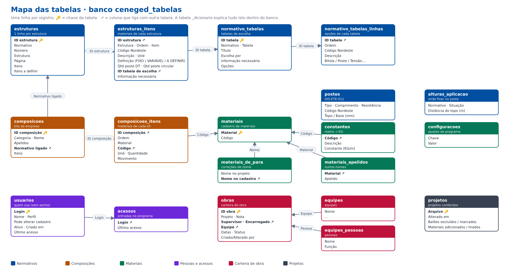

# Arquitetura

O programa é dividido em **camadas**. Cada camada só pode usar as que estão **abaixo** dela.
Assim, quem mexe numa regra de negócio não precisa abrir tela nenhuma, e quem mexe numa tela
não corre o risco de mudar uma regra sem querer.

```
┌──────────────────────────────────────────────────────────────┐
│ interface    Telas Tkinter: botões, tabelas, janelas         │
├──────────────────────────────────────────────────────────────┤
│ servicos     "Ler este PDF", "Exportar o relatório",         │
│              "Carregar a planilha dos normativos"            │
├──────────────────────────────────────────────────────────────┤
│ dominio      Regras: o que cada balão vira, normativos,      │
│              postes, conectores FLBIT/IT-R, cerca            │
├──────────────────────────────────────────────────────────────┤
│ dados        MongoDB, planilhas, usuários, composições       │
├──────────────────────────────────────────────────────────────┤
│ leitura_pdf  Visão computacional: balões, textos, cabos      │
├──────────────────────────────────────────────────────────────┤
│ comum        Funções pequenas (acentos, números)             │
└──────────────────────────────────────────────────────────────┘
```

* Só a camada `interface` usa Tkinter. Todo o resto roda sem tela: dá para usar num script,
  num teste ou, no futuro, num servidor web.
* O teste `testes/test_camadas.py` falha se alguém importar "para cima".

## Caminho de um PDF até o relatório

```
interface/app.py            o usuário adiciona o PDF
   │
servicos/projeto.py         Arquivo(pdf) → Pagina.processar()
   │   ├─ leitura_pdf/delimitacao.py    acha a área do projeto (tira carimbo e legendas)
   │   ├─ leitura_pdf/deteccao.py       acha os balões (regiões fechadas com texto)
   │   ├─ leitura_pdf/texto_*.py        lê textos desenhados (contornos / fonte de traço)
   │   ├─ leitura_pdf/rede.py           refaz a rede de cabos, metros por vão, FLBIT meio/fim
   │   └─ dominio/cerca.py              aterramento e seccionamento de cerca
   │
dominio/relatorio.py        montar_relatorio(): cada balão → materiais
   │   ├─ dominio/baloes.py             separa os materiais do texto do balão
   │   ├─ dominio/normativo.py          monta a estrutura pelo normativo e escolhe nas tabelas
   │   ├─ dominio/postes.py             tipo do poste, diâmetro no ponto (cinta, parafuso)
   │   └─ dados/composicoes.py          composições da empresa (materiais extras)
   │
servicos/exportar.py        Excel no padrão NEO (+ aba Conferência, + todos os projetos)
```

## Dados

`dados/armazenamento.py` decide onde ler/gravar:

* **MongoDB** (`dados/mongo.py`) — quando existe o arquivo `banco_mongo.txt` (endereço do banco
  com usuário e senha) na pasta do programa. Coleções: `conjuntos` (um documento por conjunto:
  cadastro, composições, usuários, normativos...), `projetos` (um por projeto), `obras` (um por obra
  da carteira) e `acessos`. Na primeira vez os dados vêm do modo OneDrive/SQLite. Sem conexão,
  nada é gravado (`SemBanco`) e a tela avisa. Cópia diária nos Documentos de quem é administrador; a versão nova do programa fica
  no próprio banco (coleção `instalador`).
* **Tabelas para ver** (`dados/tabelas_visao.py`) — banco `ceneged_tabelas` no mesmo cluster, com uma
  linha por registro e colunas em português (estruturas, estruturas_itens, normativo_tabelas,
  normativo_tabelas_linhas, postes, composicoes, composicoes_itens, materiais, usuarios, acessos,
  obras, projetos...). Refeito em segundo plano a cada gravação; `_dicionario` explica as ligações.
  É só leitura: o programa trabalha no banco `ceneged`. Mapa: `docs/Mapa_das_Tabelas.png`.

  
* **Banco** (`ceneged.db`, SQLite) — pasta de rede local.
* **Modo OneDrive** (`dados/onedrive.py`, usado antes do MongoDB; hoje só serve para levar os
  dados antigos para o banco na primeira vez) — quando a pasta de dados está no OneDrive/SharePoint:
  um arquivo por registro, gravação atômica, junção automática das cópias de conflito,
  cópia de segurança diária em `dados/_backup`.

A pasta de dados é a do programa, ou a escrita em `pasta_dados.txt`. A variável de
ambiente `CENEGED_DADOS` tem prioridade (usada nos testes e para desenvolver sem mexer nos
dados reais).

## Módulos

### `interface — telas`

| Módulo | Linhas | O que faz | Principais nomes |
|---|---:|---|---|
| `interface/app.py` | 1760 | Janela principal do programa. | `App` |
| `interface/dialogos.py` | 306 | Diálogos: escolher nome, cerca, escolher material. | `EscolherNome`, `JanelaCerca`, `EscolherMaterial` |
| `interface/login.py` | 434 | Login, troca de senha e usuários. | `TelaLogin`, `TrocarSenha`, `TelaUsuarios` |
| `interface/principal.py` | 114 | Ponto de partida: monta a janela e abre o programa. | `main`, `avisar_conflitos_od`, `oferecer_atualizacao` |
| `interface/tabelas_norma.py` | 433 | Janela para ver/editar as tabelas dos normativos. | `JanelaTabelasNorma` |
| `interface/tela_cadastro.py` | 388 | Tela do cadastro de materiais. | `TelaCadastro` |
| `interface/tela_extras.py` | 753 | Tela de materiais extras (composições). | `TelaExtras` |
| `interface/telas_cadastros.py` | 984 | Telas de equipes, obras, constantes e carteira. | `TelaEquipes`, `FormObra`, `TelaConstantes`, `TelaCarteira` |
| `interface/tema.py` | 602 | Tema visual e componentes comuns da interface (tabela, dica, ícones). | `aplicar_tema`, `desenhar_icone`, `secao`, `amostra`, `cartao`, `tabela` … |

### `servicos — casos de uso`

| Módulo | Linhas | O que faz | Principais nomes |
|---|---:|---|---|
| `servicos/exportar.py` | 160 | Exportação do relatório para Excel (NEO, conferência, todos os projetos). | `salvar_relatorio_neo`, `salvar_relatorio_todos`, `salvar_conferencia`, `salvar_relatorio` |
| `servicos/normativos.py` | 72 | Carregar a planilha dos normativos e atualizar as composições existentes. | `atualizar_composicoes_do_normativo`, `carregar_planilha_normativos` |
| `servicos/pdf_corrigido.py` | 216 | Projeto em PDF com os balões corrigidos (na tela e no arquivo que sai com o relatório). | `largura_texto`, `layout_balao_corrigido`, `baloes_alterados`, `salvar_pdf_corrigido`, `imagem_pagina_corrigida` |
| `servicos/projeto.py` | 1509 | Arquivo e Página: orquestra a leitura de um PDF e gera o relatório. | `balao_ignorado`, `Pagina`, `Arquivo` |

### `dominio — regras de negócio`

| Módulo | Linhas | O que faz | Principais nomes |
|---|---:|---|---|
| `dominio/baloes.py` | 82 | Regras do texto do balão: separar materiais, multiplicador, cabos. | `multiplicador`, `materiais_do_balao` |
| `dominio/cerca.py` | 713 | Cerca: aterramento e seccionamento, nº de fios. | `palavra_riscada`, `palavras_de_texto`, `linhas_de_texto`, `rotulos_fios`, `simbolos_cerca`, `segmentos_coloridos` … |
| `dominio/materiais.py` | 212 | Materiais: constantes, parecidos, itens dos kits, alças. | `converter_para_kg`, `achar_material_parecido`, `ligar_constantes`, `materiais_conhecidos`, `contexto_pagina`, `codigo_do_item` … |
| `dominio/normativo.py` | 420 | Escolha nas tabelas dos normativos e montagem das estruturas. | `uso_da_linha`, `origem_no_normativo`, `escolher_na_tabela`, `estrutura_do_normativo`, `material_da_composicao` |
| `dominio/postes.py` | 216 | Postes (DIS-ETE-011): tipo, geometria e altura de aplicação. | `tipo_do_poste`, `geometria_do_poste`, `altura_de_aplicacao`, `linha_pelo_poste`, `escolher_pelo_poste`, `descricao_do_codigo` … |
| `dominio/relatorio.py` | 353 | Montagem do relatório de materiais (conectores, agrupamento, ajustes). | `conector_perfurante`, `e_conector_perfurante`, `conectores_da_composicao`, `materiais_resolvidos`, `agrupar_baloes`, `montar_relatorio` … |
| `dominio/tabelas.py` | 116 | Informações dos cabos e das tabelas: região do código, faixas, cabo da rede. | `cabo_info` |

### `dados — onde as informações ficam`

| Módulo | Linhas | O que faz | Principais nomes |
|---|---:|---|---|
| `dados/armazenamento.py` | 94 | Leitura/gravação dos conjuntos de dados (escolhe banco ou OneDrive) e configurações. | `ler_dados`, `versao_dados`, `salvar_json` |
| `dados/atualizacao.py` | 66 | Atualização automática do programa instalado. | `versao_instalada`, `atualizacao_disponivel`, `instalar_atualizacao` |
| `dados/banco.py` | 180 | Banco SQLite (ceneged.db) e tabelas de consulta. | `montar_tabelas_de_consulta` |
| `dados/cadastro.py` | 217 | Cadastro de materiais (nome usado na empresa). | `bitolas_do_cabo`, `Cadastro` |
| `dados/caminhos.py` | 233 | Onde ficam o programa e os dados (pasta_dados.txt). | `pasta_programa`, `pasta_dados`, `tem_dados`, `procurar_pasta_dados`, `fixar_pasta_no_computador`, `reiniciar_programa` … |
| `dados/composicoes.py` | 281 | Composições (materiais extras / kits). | `kit_limpo`, `titulo_kit`, `kit_por_metro`, `poste_do_kit`, `Composicoes` |
| `dados/constantes.py` | 87 | Constantes (metro -> KG). | `Constantes` |
| `dados/equipes.py` | 311 | Equipes, carteira de obras e memória de projetos. | `data_br`, `nome_mes`, `data_ordem`, `ArquivoDados`, `Equipes`, `Carteira` … |
| `dados/mongo.py` | 397 | Modo MongoDB (banco na nuvem): conjuntos, projetos e obras como documentos. | `ultimo_acesso`, `SemBanco`, `mongo_conectado`, `mongo_ler_dados`, `mongo_salvar`, `mongo_versao` … |
| `dados/normativos.py` | 269 | Planilha dos normativos: leitura, carga e atualização das composições. | `DadosNorma`, `ler_planilha_normativos` |
| `dados/onedrive.py` | 268 | Modo OneDrive: um arquivo por registro, junção de conflitos, cópia diária. | `od_ler_dados`, `od_versao`, `od_salvar`, `od_copia_do_dia`, `od_registrar_acesso` |
| `dados/planilhas.py` | 392 | Leitura e gravação das planilhas (materiais, constantes, carteira, composições). | `ler_planilha_materiais`, `salvar_modelo_planilha`, `ler_planilha_constantes`, `ler_planilha_carteira`, `salvar_planilha_carteira`, `ler_planilha_composicoes` … |
| `dados/planilhas_normativos.py` | 254 | Exportação da planilha dos normativos e modelos para download. | `salvar_planilha_normativos`, `salvar_modelo_composicoes`, `salvar_modelo_normativos` |
| `dados/tabelas_visao.py` | 351 | Banco ceneged_tabelas: as tabelas para ver (uma linha por registro), atualizadas a cada gravação. | `tabelas_visao`, `atualizar_tabelas_visao`, `conferir_tabelas_visao` |
| `dados/usuarios.py` | 133 | Usuários, login e senhas. | `Usuarios` |

### `leitura_pdf — visão computacional`

| Módulo | Linhas | O que faz | Principais nomes |
|---|---:|---|---|
| `leitura_pdf/comprimentos.py` | 170 | Leitor próprio de comprimentos ("45m") desenhados como linhas no PDF. |  |
| `leitura_pdf/delimitacao.py` | 255 | Delimitação automática da área do projeto. | `delimitar_automatico` |
| `leitura_pdf/deteccao.py` | 966 | Núcleo da detecção de balões (sem interface): regiões fechadas, texto, filtros. | `ler_caracteres`, `remover_textos`, `remover_imagens`, `afinar_tracos`, `montar_texto`, `angulo_texto` … |
| `leitura_pdf/rede.py` | 745 | Rede de cabos: linhas tracejadas, comprimentos por vão, FLBIT/FLABIT meio/fim. | `tracos_dos_caminhos`, `tracejados_soltos`, `tracos_da_pagina`, `Rede`, `ancoras_de_cabo`, `linhas_coloridas` … |
| `leitura_pdf/texto_contornos.py` | 6091 | Leitura de texto convertido em contornos (PDF sem texto selecionável). | `cor_do_objeto`, `objetos_preenchidos`, `ler_texto_vetorial`, `ler_caixa_raster`, `ler_texto_de_traco`, `remover_objetos` |
| `leitura_pdf/texto_traco.py` | 365 | Leitura de textos na fonte de traço do CAD (projetos "empilhados"). | `estimar_inclinacao_traco`, `ler_linha_traco` |
| `leitura_pdf/vetores.py` | 261 | Vetores da página: caminhos, caixas e pilhas de caixas. | `coletar_caminhos`, `caixas_vetoriais`, `retangulos_de_linhas`, `contar_pilhas`, `pilhas_de_caixas`, `TextoTraco` |

### `comum — utilidades`

| Módulo | Linhas | O que faz | Principais nomes |
|---|---:|---|---|
| `comum/texto.py` | 133 | Funções de texto usadas em todas as camadas (acentos, comparação de nomes). | `chave_nome`, `semelhanca`, `normaliza_codigo`, `info_poste`, `fmt_num`, `formata_num` … |

## Pontos de atenção (dívida técnica conhecida)

Esta organização foi feita **sem mudar nenhuma regra**: o código de cada função é o mesmo do
arquivo único antigo (`encontrar_baloes.py`), só foi distribuído em módulos. Por isso ficaram
alguns pontos para melhorar com calma:

1. **Objetos criados ao importar.** `CADASTRO`, `COMPOSICOES`, `USUARIOS`, `EQUIPES`,
   `CARTEIRA` e `CONSTANTES` são criados quando o módulo é importado, lendo a pasta de dados.
   O ideal é criá-los em `interface/principal.py` e passá-los adiante.
2. **Dois imports "tardios"** (dentro da função, marcados com `# import tardio`):
   * `dominio/baloes.py` usa `COMPOSICOES` (de `dados/composicoes.py`);
   * `leitura_pdf/texto_contornos.py` usa `tracos_dos_caminhos` e `tracejados_soltos`
     (de `leitura_pdf/rede.py`).
   Funcionam, mas mostram dependências que podem ser desfeitas.
3. **Arquivos grandes.**
   * `leitura_pdf/texto_contornos.py` (~6 000 linhas): a maior parte são os modelos das
     letras guardados no código. Podem virar um arquivo de dados.
   * `servicos/projeto.py` (`Pagina`, ~1 400 linhas) e `interface/app.py` (`App`, ~1 700
     linhas) podem ser quebrados em partes menores.
4. **Funções com `_` na frente** são internas, mas algumas são usadas por outros módulos
   (ex.: `_sem_acento`, `_num`). Com o tempo, vale dar nomes públicos a elas.
